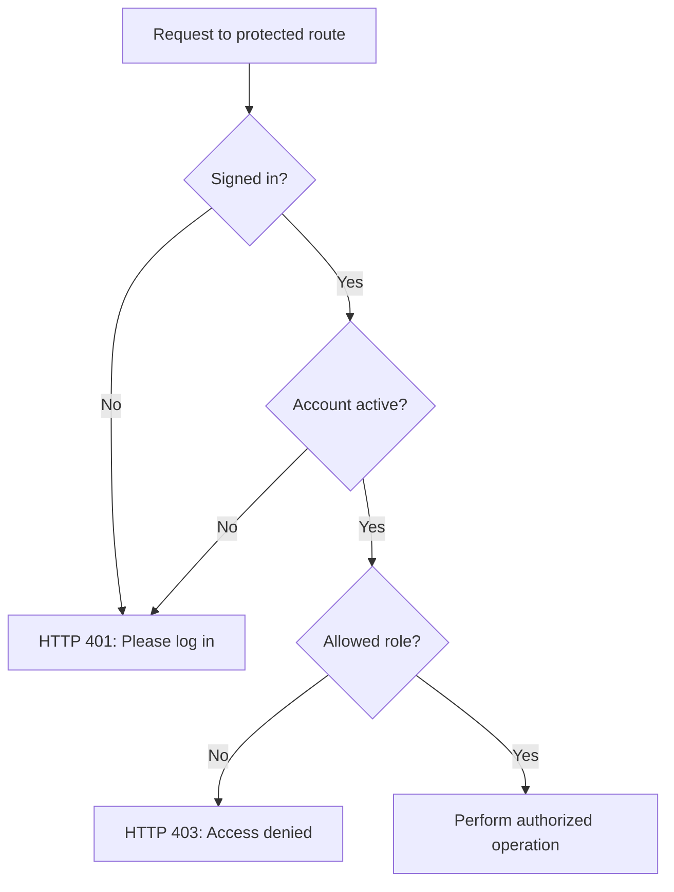
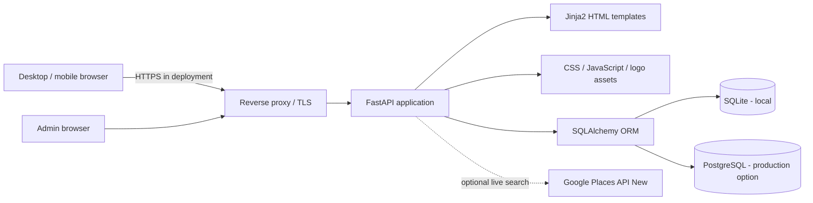
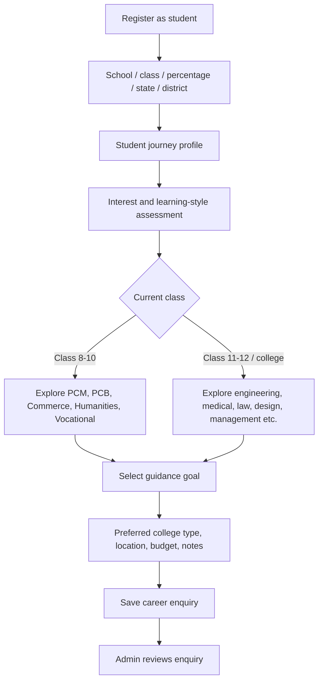
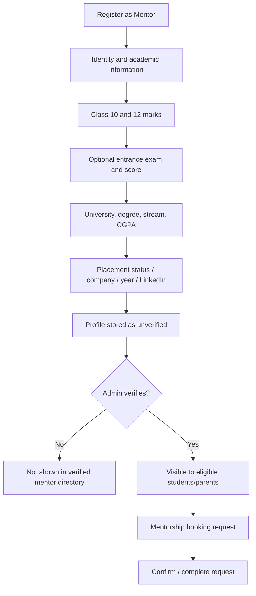
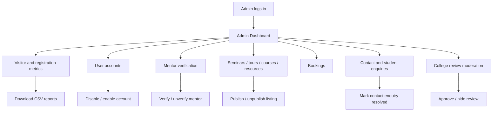
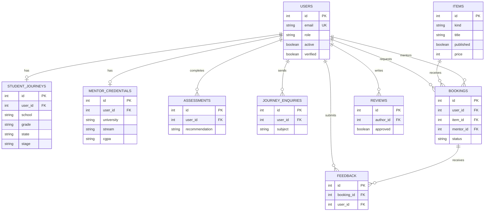
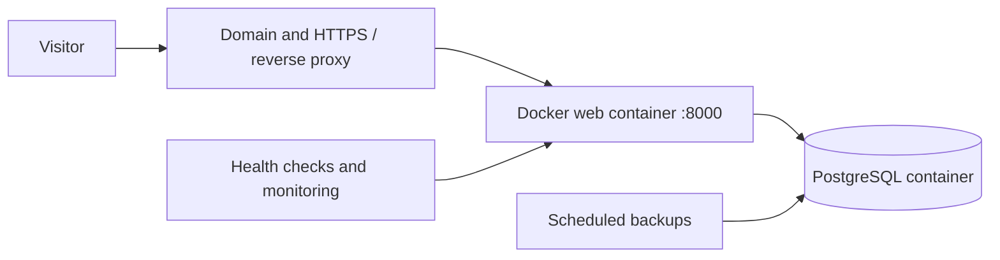
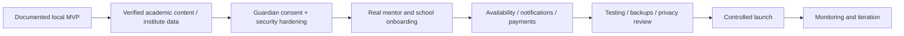

# CareerSathi — Complete Project Documentation

> **Guiding Futures, Building Careers**  
> Career guidance, mentorship, educational resources and college research for Indian learners.

**Founder & Developer:** Mohammad Sarfraz Khan  
**Location:** Sitamarhi, Bihar, India  
**Contact:** +91 83407 83239  
**Documentation version:** 1.0 — 24 October 2026  
**Code reference:** CareerSathi V9 source plus V10/V11 branding updates. This document describes the code inspected, not a claim that a production site is already hosted or all integrations are live.

---

## Contents

1. [Vision and scope](#1-vision-and-scope)
2. [Feature overview and implementation status](#2-feature-overview-and-implementation-status)
3. [Roles and permissions](#3-roles-and-permissions)
4. [Overall architecture](#4-overall-architecture)
5. [Student lifecycle](#5-student-lifecycle)
6. [Mentor lifecycle](#6-mentor-lifecycle)
7. [Parent and school experience](#7-parent-and-school-experience)
8. [Admin console](#8-admin-console)
9. [Colleges, tours and institute search](#9-colleges-tours-and-institute-search)
10. [Courses and resources](#10-courses-and-resources)
11. [Database and entity relationships](#11-database-and-entity-relationships)
12. [Routes and operations](#12-routes-and-operations)
13. [Project files](#13-project-files)
14. [Local setup: Windows](#14-local-setup-windows)
15. [Deployment with Docker and PostgreSQL](#15-deployment-with-docker-and-postgresql)
16. [Security, privacy and safeguarding](#16-security-privacy-and-safeguarding)
17. [Testing and troubleshooting](#17-testing-and-troubleshooting)
18. [Roadmap and launch checklist](#18-roadmap-and-launch-checklist)

---

## 1. Vision and scope

CareerSathi is an education and career-guidance startup intended to help school students—particularly Classes 8–12—and their families understand academic streams, colleges, mentoring and career opportunities. The original business-plan PDF outlines school seminars, alumni/professional mentorship, college selection and tours, skill development, internships and job-readiness services. Its Software Requirements Specification (SRS), pages 23–28, names five principal user roles: **student, parent, mentor, school/college and admin**. It proposes an interactive platform, with long-term AI assessments, performance, security and accessibility goals.

The implemented website is a **server-rendered FastAPI application**, not the React/Node/Mongo stack proposed in the SRS. It uses Jinja2 templates, SQLAlchemy, SQLite for local development and optional PostgreSQL for cloud deployment. This is an architectural deviation, not evidence that the original React/Node stack was implemented.

### What the brand stands for

- **Guidance:** help students explore, rather than guarantee a perfect stream or admission.
- **Transparency:** distinguish public institute references from actual CareerSathi partnerships.
- **Learning:** free theoretical introductions and self-study resources.
- **Trust:** admin-controlled mentor verification and review moderation.
- **Reach:** enquiries with location information and optional live institute discovery.

The brand tagline must be shown once per designed brand unit: **“Guiding Futures, Building Careers”**. In the latest header design, it sits immediately beneath the compact logo. In the footer, avoid displaying the tagline twice (V11 fixed a duplicate small tagline).

## 2. Feature overview and implementation status

| Feature | Present in inspected code? | Explanation / caveat |
|---|---|---|
| Public home/about/contact/legal pages | Yes | Legal text is a draft, not lawyer-approved. |
| Student/parent/mentor/school accounts | Yes | No public admin signup. |
| Student onboarding journey | Yes | Profile → interest assessment → choice → enquiry. |
| Class-specific student choices | Yes | Class 10 streams; Class 12 courses/careers and exam context. |
| Mentor academic registration | Yes | Marks, exams, college, degree, stream, CGPA, placement details. |
| Admin mentor verification | Yes | Admin controls verified flag; not external credential authentication. |
| Role-aware dashboards | Yes | Availability depends on current role. |
| Seminar / tour / course / internship listings | Yes | Real scheduled opportunities need admin-created records. |
| Mentor requests and booking status | Yes | Request and confirmation workflow, no native video call. |
| Career interest assessment | Yes, basic | Rule-based recommendations; **not** a validated AI psychometric test. |
| College research profiles and comparison | Yes | A curated list of 44 reference institutions, not exhaustive. |
| Google Places live institute lookup | Optional | Requires restricted server-side API key and billing; availability and usage subject to Google. |
| Course content library | Yes via seed scripts | Content loading requires scripts; lessons are introductory, not accredited qualifications. |
| Enquiry and review moderation | Yes | Admin resolves enquiries and approves/hides reviews. |
| Admin visitor analytics and CSV export | Yes | Visits and approximate cookie-based distinct browsers, not exact humans. |
| Payment checkout / subscriptions | No | Booking payment status may be `unpaid`; no payment provider integration. |
| Real video sessions / messaging | No | Requires conferencing provider integration. |
| OTP/email verification, reset, MFA | No | Needed before broad public launch. |
| Guardian consent and child privacy lifecycle | No | Must be designed and implemented before collecting minors' data at scale. |
| 1,000 concurrent-user / 99.9% uptime guarantee | Not verified | These are targets in the PDF, not tested results. |

## 3. Roles and permissions

| Role | Registration | Activities | Restrictions |
|---|---|---|---|
| Visitor | No | Browse public pages, college references, materials, contact enquiry, basic assessment | Cannot book protected sessions or enter admin console. |
| Student | Yes | Education profile, assessment, stream/career choice, enquiry, bookings, reviews, own dashboard | Cannot verify mentors or manage others' users. |
| Parent | Yes | Browse content, request mentorship/services and view own bookings | No access to admin records. |
| Mentor | Yes | Academic profile, update expertise, receive/confirm assigned mentor requests | Public mentor listing requires admin verification. |
| School/College | Yes (`school` role) | School account and services/seminar requests | Detailed institution reports per PDF are not implemented. |
| Admin | Created through CLI | User access, mentor verification, events/content, approvals, enquiries, metrics and CSV export | Must be created securely; not selectable in public signup. |

### Access-control flow



A user with valid credentials but a non-admin role will receive **403** at `/admin/dashboard`. Wrong credentials or a disabled account produces **401** on login.

## 4. Overall architecture



**Backend:** `app.py` defines application routes, validation, database models, sessions, role checks and analytics middleware. **Presentation:** `templates/` plus `static/`. **Data:** stored in SQLite unless `DATABASE_URL` points to PostgreSQL. **External dependency:** Google Places API is optional. API keys must never be committed to source or exposed to browsers.

The database alternatives in the diagram are **either/or**, not both active simultaneously for a single deployment.

## 5. Student lifecycle



### Student registration and journey details

The signup form accepts name, email, password, role and optional student fields such as class, school name, percentage, state, city and purpose. The registration handler creates a `users` row and a `student_journeys` row, then sends students to `/journey`.

The student journey supports grades 8, 9, 10, 11, 12, `college`, and `other`. It captures school, class, percentage (validated 0–100 when supplied), region, exam and score, and desired outcome. For students considering Class 10 subject streams, the assessment ranks **Science (PCM), Science (PCB), Commerce and Arts/Humanities** using transparent hand-written weights. The enquiry stage additionally offers **Vocational/Diploma**, and a broader range of post-school goals: engineering, medical/healthcare, law, design, management, government exams, scholarship, admission and mentorship.

Class 12 learners can record entrance examination context (for example JEE or NEET) and exam result text. The platform does **not** calculate reliable admission predictions or confirm cutoffs. The code requires at least one completed assessment before a student can send a career journey enquiry. Students can also browse resources, request mentors and book published activities separately.

### Student data safety

This application targets minors. School details, exam results and interests are personal data. A production implementation needs guardian authorization, explicit notices, careful retention rules, access logging and account/data deletion processes. Do not treat the current form alone as a legally complete consent flow.

## 6. Mentor lifecycle



Implemented mentor fields include Class 10 marks, Class 12 marks, optional entrance exam name/score (such as JEE/NEET), college/university, degree, stream, CGPA, placement status, company, graduation year, LinkedIn and expertise. They live in the `mentor_credentials` table linked one-to-one to the mentor's user ID. The web profile editor supports updates, which should be reviewed as part of the verification process.

Admin marking a mentor `verified` is an **internal approval flag**, not proof that a degree, marksheet, employment claim or LinkedIn account has been independently verified. Add a documentary review and safeguarding process before using a “Verified Mentor” label as a real-world guarantee.

## 7. Parent and school experience

**Parents:** Can register, log in, browse courses/resources, choose mentors, book applicable services and review own booking requests. The PDF additionally imagines parent-specific progress dashboards; these are **not equivalent to a fully implemented guardian-linked student report system** in the inspected code.

**Schools and colleges:** The `school` account type can access the relevant role-aware dashboard and published educational services. Schools can submit seminar-related enquiries or requests. Institution performance reports, detailed school CRM, verified school directory ingestion and seminar venue management require further development.

## 8. Admin console

**URL:** `http://127.0.0.1:8000/admin/dashboard` (local development).  
**Login:** `/login`.  
**CLI:** `python create_admin.py`.

### Admin workflow



### Dashboard metrics

Backend aggregates `users`, active users, `visits`, distinct `visitor` cookies, `bookings`, unresolved `inquiries` and pending `reviews`. It also prepares a **14-day visit chart**. Lists currently query the most recent records, with limits: 25 users/bookings/items, 20 contact enquiries/reviews and 50 student journey enquiries. CSV exports are available for `users`, `bookings` and `visits`.

**Visitor counting nuance:** one user can create many page-view records; the unique count is based on a browser cookie and may over/underestimate actual humans. This is not Google Analytics and does not provide identity of anonymous visitors.

### Create or reset admin credentials

```powershell
.\.venv\Scripts\Activate.ps1
python create_admin.py
```

The script asks for admin email, name and a password of at least 12 characters. **If that email already belongs to an admin, the script updates their password and reactivates them.** If the email belongs to a non-admin user, it refuses to elevate that account. It does **not** delete user records. The secret password is entered invisibly via `getpass`.

Never expose this script or host command access to ordinary users. Once production is live, rotate unused admin credentials and implement MFA.

## 9. Colleges, tours and institute search

- `/colleges` — reference college directory and review section.
- `/college/{college_id}` — college reference profile.
- `/college-compare?ids=...` — compare a few curated institutions.
- `/explore/tour` — college references plus actual admin-published tours.
- `/institutes` — legacy URL; inspected code redirects to tours.

The curated directory is a **list of 44 institutions** with names, cities, states, broad categories and official-site URLs. It is not a verified exhaustive school/college census and is not evidence of CareerSathi partnership. District/state/name search can filter the local references. Optional **Google Places API (New)** Text Search can fetch additional live matches, subject to the provider's terms, field availability, billing and per-query limits. Search results are not automatically a local permanent database.

**Location search design:** user enters college/school name → selects state → types district/city → selects institution type → searches → inspects reference/live results → follows official institute link or submits an enquiry. A **tour booking** is different: it should be presented as actually bookable only if a real date, capacity and organizer arrangement has been published by admin.

## 10. Courses and resources

The repository contains these seed/update scripts:

```powershell
python seed_content.py
python seed_lessons.py
python seed_foundations.py
python seed_v9_course_library.py
```

They populate starter career articles and courses, then extend introductory theory, examples and exercises. According to the V9 upgrade process, the combined course library targets approximately **40 seeded courses**, with enhanced long-form reading material of at least **5,000 characters per course** after running the final V9 seed. Running the scripts against your database is required to get the expanded content; copying templates alone is insufficient. Verify actual count/content using your running site and database instead of relying solely on an advertised number.

Typical topics include Python, HTML/CSS, JavaScript, SQL, AI/data science, science, financial literacy, public speaking, design, entrepreneurship, communication, stream selection and careers after Class 12.

**Learning sequence:** choose course → read introduction and fundamentals → review examples → attempt activities/exercises → select “Sign up”, “Find a mentor” or “Enquire” for further help. Lessons are self-study guides and do not include issued certificates, automatic grading or teacher-led course playback.

## 11. Database and entity relationships



Additional independent tables: `inquiries` (public contact requests with resolved status) and `visits` (visitor cookie, page path and timestamp). The ER diagram is a simplified conceptual view of inspected SQLAlchemy models, not a migration file.

**Database preservation:** `careersathi.db` holds real local users, passwords (hashed), bookings and visitor activity. **Never replace it while installing a new ZIP.** Do not copy `.env` over the existing production environment. Back up before changes. SQLAlchemy's `create_all()` creates missing tables, but is **not** a schema migration system for arbitrary column changes; future model edits need proper migrations.

## 12. Routes and operations

| Method | Path | Description | Main access |
|---|---|---|---|
| GET | `/` | Homepage | Public |
| GET | `/about`, `/contact`, `/privacy`, `/terms` | Informational pages | Public |
| POST | `/contact` | Save contact enquiry | Public + CSRF |
| GET/POST | `/register` | Register student, parent, mentor or school | Public + CSRF on POST |
| GET/POST | `/login` | Authenticate | Public + CSRF on POST |
| POST | `/logout` | Clear login session | Signed in + CSRF |
| GET | `/dashboard`, `/profile` | Role-aware pages | Signed in |
| POST | `/profile` | Update personal/mentor fields | Signed in + CSRF |
| GET | `/journey` | Student career journey | Student |
| POST | `/journey/profile` | Student education profile | Student + CSRF |
| POST | `/journey/assessment` | Save interest assessment | Student + CSRF |
| POST | `/journey/enquiry` | Save career enquiry | Student + CSRF |
| GET/POST | `/assessment` | General interest explorer | Public; stores for signed-in users |
| GET | `/explore/{kind}` | Listing for seminar/tour/course/internship/resource | Public |
| GET | `/item/{item_id}` | Listing/lesson details | Public |
| POST | `/book/item/{item_id}` | Submit listing booking | Authorized roles + CSRF |
| GET | `/mentors`, `/mentor/{mentor_id}` | Mentors / mentor page | Public |
| POST | `/book/mentor/{mentor_id}` | Request mentor appointment | Student/parent + CSRF |
| POST | `/booking/{booking_id}/{action}` | Cancel/confirm/complete (authorized actors) | Signed in + CSRF |
| GET | `/colleges`, `/college/{college_id}`, `/college-compare` | Directory/profile/comparison | Public |
| POST | `/colleges/review` | Submit moderated college review | Signed in + CSRF |
| GET | `/admin/dashboard` | Metrics and management | Admin |
| POST | `/admin/user/{uid}/{action}` | Enable/disable/verify/unverify | Admin + CSRF |
| POST | `/admin/item` | Publish seminar/tour/course/resource/internship | Admin + CSRF |
| POST | `/admin/item/{item_id}/toggle` | Publish/unpublish | Admin + CSRF |
| POST | `/admin/review/{review_id}/{action}` | Moderate review | Admin + CSRF |
| POST | `/admin/inquiry/{inquiry_id}/resolve` | Resolve contact enquiry | Admin + CSRF |
| GET | `/admin/export/{kind}` | CSV users/bookings/visits | Admin |
| GET | `/health` | App health response | Public |

The URL list reflects the inspected `app.py` source. Consult `app.py` for exact form validation and permissible actor roles.

## 13. Project files

```text
CareerSathi/
├── app.py                      # FastAPI routes, SQLAlchemy models, auth, admin
├── create_admin.py             # Interactive admin creation/password reset
├── requirements.txt            # Python dependencies
├── .env.example                # Environment values to configure
├── .gitignore / .dockerignore
├── Dockerfile
├── docker-compose.yml          # Web + PostgreSQL for deployment
├── smoke_test.py               # Existing smoke-test script
├── seed_content.py             # Initial course/resource guides
├── seed_lessons.py             # Further self-study courses
├── seed_lessons_topics.py      # Supporting lesson topic definitions
├── seed_foundations.py         # More foundation lesson content
├── seed_v9_course_library.py   # Long-form theory expansion
├── start_local.sh              # Unix helper script
├── templates/
│   ├── base.html               # Shared header/footer and logo
│   ├── home.html               # Landing page
│   ├── auth.html               # Sign in / registration
│   ├── journey.html            # Student onboarding journey
│   ├── dashboard.html          # Role-aware user dashboard
│   ├── profile.html            # Profile / mentor credentials
│   ├── admin.html              # Admin dashboard
│   ├── mentor.html / mentors.html
│   ├── colleges.html / college_profile.html / college_compare.html
│   ├── explore.html / detail.html / institutes.html
│   ├── assessment.html / about.html / contact.html / legal.html
├── static/
│   ├── style.css               # Design system and layout
│   ├── main.js                 # Small front-end behaviour
│   └── brand/                 # Logo, icon, favicon, manifest
└── careersathi.db              # CREATED LOCALLY; preserve and back up
```

Note: V10/V11 deliverables were **patch ZIPs**, not a complete new backend. V11 specifically updates `templates/base.html`; combine it with the matching full source version, not as a standalone application.

## 14. Local setup: Windows

### Requirements

- Python 3.11 or newer, PowerShell and an internet connection for dependency installation.
- Full source ZIP, extracted so `app.py` is directly inside the active `CareerSathi` folder.

### First install

```powershell
cd "C:\Users\sarfr\Desktop\Sarfraz Khan\Data Science\Project\CareerSathi"
python -m venv .venv
.\.venv\Scripts\Activate.ps1
python -m pip install -r requirements.txt
python create_admin.py
python seed_content.py
python seed_lessons.py
python seed_foundations.py
python seed_v9_course_library.py
python -m uvicorn app:app --reload
```

Use `http://127.0.0.1:8000/`, `/register`, `/login`, `/explore/course`, `/explore/tour`, and `/admin/dashboard`. Leave the PowerShell server running while browsing.

### Upgrade existing installation

1. Stop the server (`Ctrl+C`) and **copy the entire current project to a backup folder**.
2. Back up `careersathi.db` and `.env` separately.
3. Copy updated source/templates/static files from the new full-source ZIP. **Do not overwrite `careersathi.db`, `.env` or local secrets.**
4. Run `python -m pip install -r requirements.txt`, then appropriate seed scripts.
5. Run `python -c "import app; print('Backend import OK')"` before starting Uvicorn.
6. Run `python -m uvicorn app:app --reload`, then hard-refresh the browser (`Ctrl+F5`).

### Optional local Google Places key

```powershell
$env:GOOGLE_PLACES_API_KEY="YOUR_RESTRICTED_SERVER_SIDE_KEY"
python -m uvicorn app:app --reload
```

A Google Cloud project with API enabled and billing is required; calls may incur fees. Do not share the key in chat, screenshots, source control or frontend scripts.

## 15. Deployment with Docker and PostgreSQL



The provided `docker-compose.yml` builds the web service and runs PostgreSQL 16 with persistent `pgdata`. It binds the app to host loopback on port 8000, so configure a separate TLS reverse proxy.

```bash
cp .env.example .env
# Set strong SECRET_KEY and DB_PASSWORD in .env
# Optionally set a restricted GOOGLE_PLACES_API_KEY
docker compose up -d --build
docker compose exec web python create_admin.py
```

Point your HTTPS proxy at `127.0.0.1:8000`. Verify `/health`, configure firewall, certificates, secure session cookies, backups and restore drills. The Compose web environment currently includes `APP_ENV`, `SECRET_KEY`, `DATABASE_URL`; **Google Places key is not passed through in the inspected Compose file**, so explicitly add the necessary environment mapping if hosting live lookup in Docker.

**Do not deploy directly with `--reload` or SQLite as the default production architecture.** These files are a deployment starting point, not a fully hardened hosting environment. Stripe/Razorpay, email, SMS, storage, audit logs and other operational services are not supplied.

## 16. Security, privacy and safeguarding

**What exists:** salted PBKDF2 password hashes; signed HTTP-only session cookies; same-site cookies; HTTPS-only cookie flag when `APP_ENV=production`; CSRF tokens on state-changing form routes; database-backed role checks; reversible disabled accounts; approved mentor visibility; moderated reviews.

**What remains:** trusted email verification, password reset, MFA, session revocation, abuse prevention, API quotas, production secret management, independent penetration test, strong CSP, accessibility testing, data retention/deletion and parental consent. Because children can use CareerSathi, guardian and school consent flows are a **launch blocker**, not a nice-to-have. Consult qualified counsel on applicable Indian data protection and child-safety requirements before onboarding minors with sensitive educational records.

Avoid fabricating mentors, testimonials, affiliation, fees, entrance cutoffs, placements, partnerships, event availability or job guarantees.

## 17. Testing and troubleshooting

### Quick smoke checks

```powershell
python -m pip install -r requirements.txt
python -c "import app; print('Backend import OK')"
python -m uvicorn app:app --reload
```

Open `/health`: expected a small JSON object containing `"status":"ok"` and `"service":"CareerSathi"`.

`smoke_test.py` exists in the source. Its earlier expectations might predate the `/journey` post-registration flow, so inspect/update assertions before interpreting an old redirect test failure as a new application failure.

| Symptom | Likely cause | Recommended next step |
|---|---|---|
| `uvicorn` command not found | Inactive venv or missing package | Activate `.venv`; run `python -m pip install -r requirements.txt`; use `python -m uvicorn app:app --reload`. |
| `Could not import module "app"` | Wrong working folder, `app.py` missing, Python import error | Confirm `Get-ChildItem app.py`; run `python -c "import app"` to get the underlying traceback. |
| `Please log in to continue` | Protected page while unauthenticated | Visit `/login`, sign in. |
| `You do not have access to this action` | Logged-in account lacks required role (often admin) | Sign out, log in with admin credentials; confirm role and database. |
| `Invalid credentials or disabled account` | Wrong email/password, disabled account or different database | Confirm database path and account; use CLI admin reset for an existing admin email. |
| Admin password forgotten | Admin credentials unknown | Run `python create_admin.py` with same admin email to set a new password. |
| Courses not visible or too short | Seed scripts not executed against current DB | Back up DB, then run listed seed scripts in order. |
| Tour page empty | No actual confirmed tours published | Admin must publish real tour events; college references are separate. |
| School search finds no results | Only curated colleges loaded, API key missing, or provider has no match | Configure Places properly or obtain licensed/official education directory data. |
| Old logo/tagline shown | Browser cache or wrong template version | Verify `templates/base.html` and `static/style.css`, restart and hard-refresh. |

### Safe admin diagnostics (never print passwords)

If diagnosing a legacy SQLite installation, check the correct database path first. Avoid casual write statements. Back up before any database administration. Do not share user email exports publicly.

## 18. Roadmap and launch checklist



### Launch gates

- [ ] Confirm legal entity/brand ownership, correct public contact, domain and privacy notice.
- [ ] Obtain guardian consent and safeguards for younger students.
- [ ] Review and verify all mentor education/employment claims before promoting them publicly.
- [ ] Verify partner schools, actual seminar schedules and college tour arrangements.
- [ ] Configure reliable authentication recovery, email delivery and MFA for admins.
- [ ] Integrate and test payments/refunds only if paid services are launched.
- [ ] Test backup-and-restore, permission boundaries, rate limits, accessibility and load.
- [ ] Confirm production TLS, secret handling, DNS, logs, monitoring and incident response.
- [ ] Update all courses/references and verify third-party content/license permissions.
- [ ] Do not claim 1,000 concurrent users, 99.9% uptime, AI recommendations or guaranteed admissions without independently proving those capabilities.

---

### Documentation sources and version scope

- CareerSathi **38-page Startup Business Plan and SRS**: vision, roles, requested product scope and non-functional goals (especially SRS pages 23–28).
- `CareerSathi_Brand_Courses_v9.zip`: inspected `app.py`, `requirements.txt`, templates, seeding scripts, Docker config and legacy README.
- `CareerSathi_Logo_Tagline_v10.zip` and `CareerSathi_Footer_Tagline_Fix_v11.zip`: branding adjustments described in current project history. V11 is a template-only patch.

This README deliberately separates **implemented code**, **sample/reference content**, **third-party integrations requiring credentials**, and **future production requirements**. It does not invent live customers, partnerships, credentials or measured service-level outcomes.

**© 2026 CareerSathi — Guiding Futures, Building Careers.**
